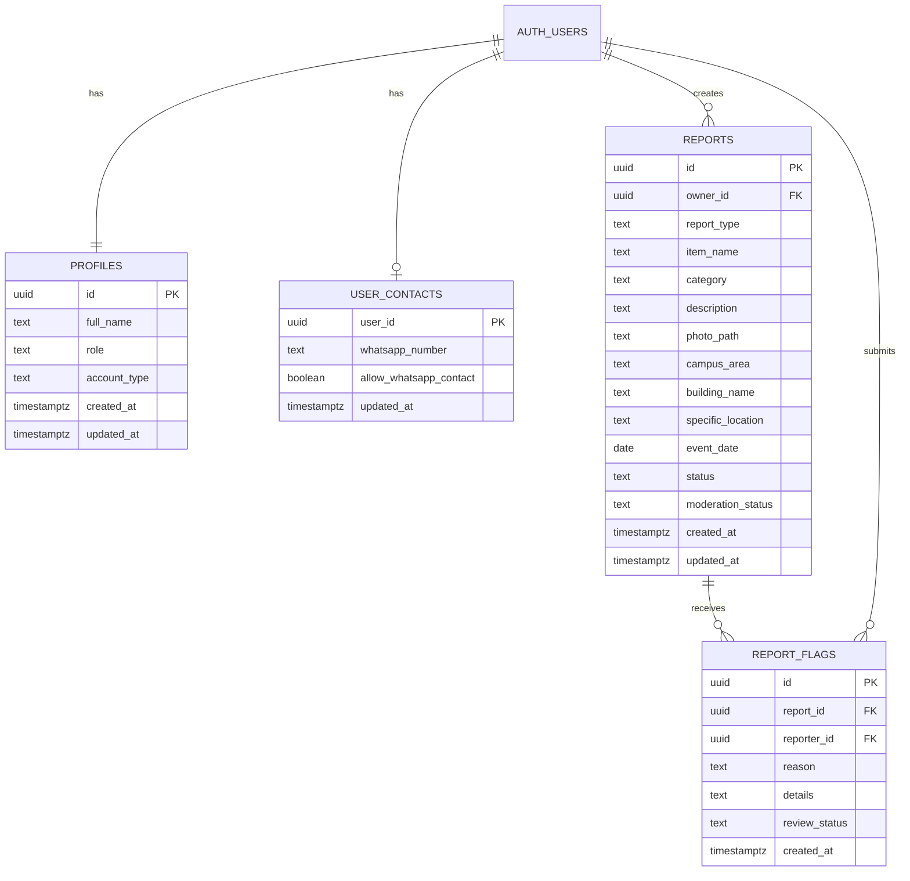

# DATA MODEL — FoundIt

**Product:** FoundIt — Lost & Found UNSRAT  
**Version:** 1.1 — MVP baseline  
**Backend:** Supabase Auth + PostgreSQL + Supabase Storage  
**Purpose:** Contract for database names, fields, relationships, and access behavior. This document is not yet a runnable SQL migration.

## 1. Simple explanation

A table stores a type of data. One row in `reports`, for example, represents one lost-item or found-item report. Supabase Auth manages accounts/passwords; the application must never store passwords in its own tables.

## 2. Key decisions

1. Use Supabase Auth for sign-up, login, password reset, and identity (`auth.uid()`).
2. Use PostgreSQL tables `profiles`, `user_contacts`, `reports`, and `report_flags`.
3. Use a read-only-to-the-client `public_reports` view for public report browsing. It exposes only public fields for reports that are both `active` and `visible`.
4. Store photos in Supabase Storage bucket `report-photos`. `reports.photo_path` stores the bucket-relative object path, not the full URL.
5. The photo bucket is public because report photos are intentionally shown to guests. Anyone who has an image URL can view it. Do not upload sensitive documents or personal information.
6. Never put WhatsApp numbers in `reports` or expose `user_contacts` directly. Contact details are retrieved through an authenticated, permission-checked database function only when the owner opts in.
7. Report description is public. It must not contain private verification clues, ID numbers, financial details, or other sensitive information. Ownership must be verified through follow-up communication.
8. Categories and campus areas are fixed lists in the app for the MVP. Verify actual faculty/area/building labels rather than inventing them.
9. Calculate matching score when needed. No `matches`, `chats`, or `notifications` table is required for MVP.
10. Admin role must be assigned through a trusted process. Registration metadata must never be allowed to set `role = 'admin'`.

## 3. Relationship diagram

`AUTH_USERS` is Supabase's managed `auth.users` table. Do not create another password/account table.

## 4. Tables and fields

### 4.1 `profiles` — public-app profile and role

One profile per Supabase Auth user, created by a database trigger after signup.

| Column | Type | Required | Rule / purpose |
|---|---|---:|---|
| `id` | `uuid` | Yes | Primary key and FK to `auth.users.id`, `ON DELETE CASCADE`. |
| `full_name` | `text` | Yes | Display name; recommended 2–80 characters. |
| `role` | `text` | Yes | `user` or `admin`; default `user`; not editable by the app user. |
| `account_type` | `text` | Yes | Informational member type selected at signup: `student` or `lecturer`; independent of authorization role. Existing accounts default to `student`. |
| `created_at` | `timestamptz` | Yes | Default `now()`. |
| `updated_at` | `timestamptz` | Yes | Updated on profile changes. |

**Permissions:** user can read their own profile and update `full_name` only. The database trigger must always set role to `user`, ignoring any user-supplied role metadata; `account_type` is validated against the allowed member types and does not grant privileges. Admin changes are performed through a trusted Supabase Dashboard/SQL procedure. Use a secure helper such as `is_admin()` for RLS policies without causing recursive profile-policy checks.

### 4.2 `user_contacts` — private contact preference

| Column | Type | Required | Rule / purpose |
|---|---|---:|---|
| `user_id` | `uuid` | Yes | Primary key and FK to `auth.users.id`, `ON DELETE CASCADE`. |
| `whatsapp_number` | `text` | Yes | Required during account registration; store normalized international digits, e.g. `6281234567890`. Nullable only for accounts created before this requirement. |
| `allow_whatsapp_contact` | `boolean` | Yes | Default `false`; explicit opt-in to be contacted about reports. |
| `updated_at` | `timestamptz` | Yes | Updated on changes. |

**Permissions:** users can read their own contact record and change only the contact preference; the phone number is collected during registration and cannot be inserted or updated directly by an authenticated client. Other users and guests cannot query this table. The app may call a database function named `get_reporter_whatsapp_for_report(report_id)` that returns a number only when all conditions hold: caller is authenticated; report exists, is `active` and `visible`; caller is not the report owner; target user has a number and opted in. Restrict function execution to `authenticated`, use a fixed safe `search_path`, schema-qualified table references, and `SECURITY DEFINER` only if needed to read protected contact data. Do not grant direct select on other users' contact rows.

### 4.3 `reports` — lost/found reports

One row equals one report. Publicly visible fields are intentionally public; do not store contact details or private clues here.

| Column | Type | Required | Rule / purpose |
|---|---|---:|---|
| `id` | `uuid` | Yes | Primary key, generated by database. |
| `owner_id` | `uuid` | Yes | FK to `auth.users.id`; default from `auth.uid()` where supported; immutable to the client. |
| `report_type` | `text` | Yes | `lost` or `found`. |
| `item_name` | `text` | Yes | Short name, e.g. `Dompet hitam`; recommended maximum 100 characters. |
| `category` | `text` | Yes | One fixed key from Section 5. |
| `description` | `text` | No | Public description; recommended maximum 500 characters. Do not include private verification clues or sensitive IDs. |
| `photo_path` | `text` | No | Storage object path, e.g. `{report_id}/photo` (no extension); `NULL` if no photo. Never store bucket prefix or full URL here. |
| `campus_area` | `text` | Yes | Verified faculty/area choice. |
| `building_name` | `text` | No | Building/facility; nullable when unknown or `Lainnya`. |
| `specific_location` | `text` | No | Text such as floor, room, or landmark; no GPS coordinates in MVP. |
| `event_date` | `date` | Yes | Date item was lost/found, not the report creation date. |
| `status` | `text` | Yes | `active` or `resolved`; default `active`. |
| `moderation_status` | `text` | Yes | `visible` or `hidden`; default `visible`. Only admin can change it. |
| `created_at` | `timestamptz` | Yes | Default `now()`. |
| `updated_at` | `timestamptz` | Yes | Updated by database trigger. |

**Status semantics:**

- `active`: still searching / not yet returned.
- `resolved`: reporter considers the issue resolved.
- `visible`: may appear publicly if active.
- `hidden`: hidden by admin; this does not mean the item was returned.

**Access rules:** public feed/detail must read the `public_reports` view, not a direct public query over the full table. The view exposes only safe display fields and hard-filters `status = 'active' AND moderation_status = 'visible'`. Do not expose `owner_id` or `moderation_status` in that public view. Authenticated users can read their own reports (including resolved/hidden) and public active reports. Admin can inspect reports for moderation. Use RLS for rows and least-privilege grants for columns; don't rely only on Flutter UI. Owner ID and moderation fields must not be client-editable.

### 4.4 `report_flags` — report-abuse flags

| Column | Type | Required | Rule / purpose |
|---|---|---:|---|
| `id` | `uuid` | Yes | Primary key, generated by database. |
| `report_id` | `uuid` | Yes | FK to `reports.id`; cascade deletion with report. |
| `reporter_id` | `uuid` | Yes | FK to `auth.users.id`; should equal `auth.uid()` at insertion. |
| `reason` | `text` | Yes | `spam`, `false_information`, `inappropriate`, `personal_data`, or `other`. |
| `details` | `text` | No | Extra context, recommended max 300 characters. |
| `review_status` | `text` | Yes | `open`, `reviewed`, or `dismissed`; default `open`; only admin changes it. |
| `created_at` | `timestamptz` | Yes | Default `now()`. |

Add a unique constraint on (`report_id`, `reporter_id`) so an account cannot repeatedly flag the same report. Users cannot flag their own reports. A user may read only the flags they submitted; admins may read/review all flags.

## 5. Fixed values

### 5.1 Report type

| Database key | UI label |
|---|---|
| `lost` | Barang Hilang |
| `found` | Barang Ditemukan |

### 5.2 Item category

| Database key | UI label |
|---|---|
| `electronics_gadgets` | Elektronik & Gadget |
| `wallet_money` | Dompet & Uang |
| `cards_documents` | Kartu & Dokumen |
| `keys_access` | Kunci & Akses |
| `bags_pouches` | Tas & Pouch |
| `books_stationery` | Buku & Alat Tulis |
| `clothing_equipment` | Pakaian & Perlengkapan |
| `personal_accessories` | Aksesori Pribadi |
| `bottles_food_containers` | Botol & Wadah Makanan |
| `other` | Lainnya |

### 5.3 Location values

No separate locations table is needed for MVP. Form uses:

1. `campus_area`: verified faculty/area choices, plus `Area Umum Kampus` and `Tidak tahu`.
2. `building_name`: a controlled list for the selected area when available, plus `Lainnya` and `Tidak tahu`.
3. `specific_location`: free text such as floor, room, or landmark.

Verify campus/facility lists before shipping. Don't invent an official building name. Store consistent selected strings to keep filters reliable.

## 6. Matching logic

No `matches` table is needed. A deterministic Dart function computes the score when opening the matching screen or after a report is created.

1. Candidate reports must be `active` and `visible`.
2. Compare only opposite report types: `lost` with `found`.
3. Maximum score is 100:
   - same category: 30 points;
   - item name/public description keyword similarity: up to 30 points;
   - location: up to 25 points (area, building, and similar landmark text);
   - event date proximity: up to 15 points.
4. Initial threshold is 60/100; test and tune it using sample data.
5. Label the result `Kemungkinan cocok`. The score is not a probability or proof that the items are the same.
6. Matching uses only public report fields. Don't read or expose another user's contact table as part of matching.

## 7. Supabase Storage — report photos

**Bucket ID:** `report-photos`  
**Access choice:** public bucket for deliberately public report images.

- Store one optional JPEG/PNG/WebP image per report; compress to approximately 1 MB or less.
- Fixed object path: `{report_id}/photo` (no extension; avoids exposing owner UUID).
- Store only the relative object path in `reports.photo_path` (e.g. `{report_id}/photo`). Build the public URL using the Storage client when displaying the photo: `supabase.storage.from('report-photos').getPublicUrl(photoPath)`.
- A public bucket allows anyone with the asset URL to retrieve that image; Storage policies restrict upload, overwrite, and deletion. Never upload sensitive documents, readable identity/bank numbers, or private photos.
- Storage RLS restricts upload, view, and replacement to objects where the folder corresponds to an existing report owned by the authenticated user (`EXISTS (SELECT 1 FROM public.reports r WHERE r.id::text = (storage.foldername(name))[1] AND r.owner_id = auth.uid())`) and the filename is strictly `photo`. Delete is allowed to the report owner or an admin whose role is checked by `is_admin()`.
- When the user replaces/deletes a report photo, remove or overwrite the object through the Storage API. If a report is hidden due to sensitive image content, moderation should also remove the object. Do not modify Supabase's `storage` schema directly; use Storage APIs.
- Upload flow: create report in `public.reports` first → upload image to `{report_id}/photo` with matching MIME contentType → update `photo_path`. If upload fails, retain the report without an image and inform the user. Clean up orphaned objects where feasible.

## 8. Row Level Security and permissions matrix

Enable RLS on every exposed table. RLS policies and SQL grants work together; neither replaces the other.

| Data/action | Guest (`anon`) | Signed-in user | Report owner | Admin |
|---|---|---|---|---|
| Read public active/visible reports | Via `public_reports` view | Yes | Yes | Yes |
| Read resolved/hidden report | No | No unless own | Own only | Yes |
| Create report | No | Yes | Yes | Yes if needed |
| Edit/delete report | No | No except own | Own only | Admin action as needed |
| Read own profile/contact | No | Own row | Own row | Own row; contacts only as needed |
| Read another user's contact table row directly | No | No | No | No by default |
| Request WhatsApp number via function | No | Yes if conditions pass | Not for own report | Only if justified and permitted |
| Submit flag | No | Yes; not own report | No for own report | Optional |
| Review flags/hide report | No | No | No | Yes |
| Change role to admin | No | No | No | Trusted dashboard/SQL only |

Implementation requirements:

- Use `auth.uid()` in owner policies; do not trust an `owner_id` sent from the client.
- Create an `is_admin()` helper with careful permissions and a fixed safe `search_path`, if needed for admin policies.
- Restrict column grants so the client cannot change `owner_id`, `role`, `moderation_status`, or `report_flags.review_status` directly. Admin-only changes should use an RPC/function that checks `is_admin()`.
- `public_reports` must contain an explicit list of safe columns and fixed filters; never include contact data or owner IDs. Expose SELECT on the view to `anon` and `authenticated`, but keep base-table grants least-privilege.
- `user_contacts` must not be publicly selectable. `get_reporter_whatsapp_for_report` must be callable only by `authenticated` and enforce contact opt-in and report visibility.
- Never put Supabase `service_role`/secret key in Flutter, source control, screenshots, or prompts. The client uses only the project URL and publishable/anon key, with RLS enabled.

## 9. Suggested indexes and constraints

- `reports(status, moderation_status, created_at DESC)` for feed.
- `reports(report_type, category, status)` for type/category filters.
- `reports(campus_area, building_name)` for location filters.
- `reports(owner_id, created_at DESC)` for My Reports (index does not mean owner ID is exposed to client).
- `report_flags(report_id, review_status)` for moderation.
- Checks for report type/category/status/moderation status and flag reason/review status.
- Foreign keys and unique constraints described in the table sections.

Avoid adding a full-text search service during MVP. Start with simple keyword matching for `item_name` and `description` and test with example reports.

## 10. Migration and implementation rules

- The schema is a specification, not an executable migration yet. Create a reviewed SQL migration under `supabase/migrations/` before integrating real app data.
- Create the profile-on-signup trigger so each Auth user gets a `profiles` row; it must always set role to `user`.
- Create and test policies for tables, view, and Storage separately.
- Do not make tables public or disable RLS merely to fix errors.
- Test with guest/anon, user A, user B, and admin accounts.
- Do not create extra tables such as `matches`, `chats`, or `notifications` unless the project scope is deliberately revised.

## 11. Official references

- Supabase RLS: https://supabase.com/docs/guides/database/postgres/row-level-security
- Supabase user management: https://supabase.com/docs/guides/auth/managing-user-data
- Supabase Storage access control: https://supabase.com/docs/guides/storage/security/access-control
- Supabase Storage buckets: https://supabase.com/docs/guides/storage/buckets/fundamentals
- Supabase Storage quickstart: https://supabase.com/docs/guides/storage/quickstart

---

**Next implementation artifact:** a SQL migration and RLS/Storage policies based on this document, reviewed and tested before the Flutter app uses real data.
